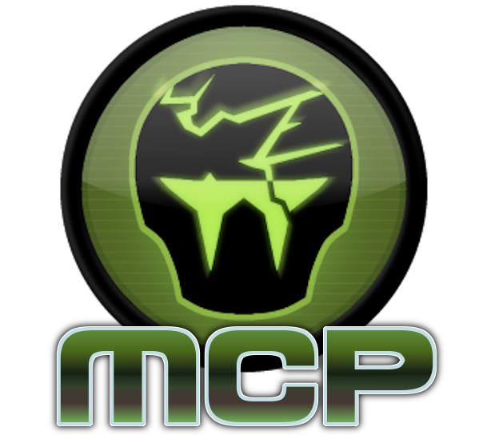

<p align="center">
  
</p>

# zandronum-mcp


Let an AI assistant supercharge Zandronum development from your editor: Write C++ code, ACS, DECORATE, fix bugs, the works.


## Setup

1. Download the engine. Grab the build for your OS from
   [Releases](https://github.com/rc4l/ZandronumMCP/releases) and unzip it anywhere.
   - Windows: `zandronum-mcp-engine-windows-x64.zip`.
   - macOS: `zandronum-mcp-engine-macos-x64.zip` (Intel build, runs under Rosetta 2).
   - Linux or a custom build: [build it yourself](https://github.com/rc4l/ZandronumMCP/blob/main/docs/ADVANCED.md).

2. Learn how to add MCP Servers to your preferred editor. In VS Code, put this in `.vscode/mcp.json` (Cursor, Claude
   Desktop, Windsurf, etc. uses something similar. Go look it up yourself or have your AI agent do it for you)

   ```json
   {
     "servers": {
       "zandronum": {
         "command": "npx",
         "args": ["-y", "zandronum-mcp"],
         "env": {
           "ZANDRONUM_EXE": "C:/path/to/zandronum-mcp-hooks.exe"
         }
       }
     }
   }
   ```

   Point `ZANDRONUM_EXE` at the `zandronum-mcp-hooks.exe` or `zandronum-mcp-hooks.app` you just unzipped, then restart your chat session.

   > **Working on several checkouts at once?** You don't need to do anything. The
   > bridge port is derived from the engine path, so each build gets its own port
   > range, each checkout's launched engines run on their own `-config`
   > (`zandronum-mcp.ini` beside the engine) instead of your system-wide
   > `zandronum.ini` (launch with `config: "isolated"` to give one instance a
   > private copy of it), and instance numbers are scoped to your
   > session — one editor window can never drive another's game. Set
   > `ZANDRONUM_BRIDGE_PORT` only if you want to pin a specific port.

4. Verify with your preferred AI Agent by asking it, "Is Zandronum MCP loaded?" if it responds positively, then it is wired up.

5. You're done. You can now ask your agent to start working on the engine or start making mods. Remember, the MCP only works with the custom build of Zandronum you downloaded or built from step 1.

## Tools

The server exposes tools (run, ACS, DECORATE, scripts, map & render inspection, saves,
process control, etc). Your agent discovers them automatically; for a browsable list see
[README.tools.md](https://github.com/rc4l/ZandronumMCP/blob/main/README.tools.md).

## Playtest marks

While playing on an MCP-launched instance, mark the moments you want to talk about:

1. Once, in that instance's console: `bind <key> mcp_mark`. It is saved to the MCP instance's own
   config, not your normal one. `mcp_mark <note>` typed in the console works too.
2. Optional, for a mod with rounds: `set mcp_mark_round <ScriptName>`, an ACS script that returns
   the round number with `SetResultValue` and doesn't `Delay`. Each mark then records the round.
3. Each press logs the tic, map, position and round, and saves a screenshot. Then ask your agent
   to "read mark 3": its `read_marks` tool lists the marks and shows a mark's screenshot.

## Demo fixtures

A recorded demo can serve as a regression test for a mod: record a route once, bless it, and
check it after each change to see whether the game still plays it the same way.

1. **Record.** Ask for a launch with `record: "route1"` (and a `map`, or a `save` to start from).
   The take goes to `route1.lmp` in `ZANDRONUM_DEMO_DIR`, else the engine's folder, with a
   `route1.json` sidecar naming the iwad, files (sha1, git rev) and map it was recorded against.
   Play it yourself (the mouse is on for a recording), then `kill_instance`, which writes the take.
2. **Watch or inspect.** `play_demo` with `hold: true` holds the demo frozen at its first tic;
   `step` and `seek_demo` then move through it exactly, and every inspection tool works at any tic.
3. **Bless.** `check_demo` with `bless: true` replays it and stores a playsim checkpoint every 35
   tics in the sidecar, plus each actor's values in `route1.rows.json.gz`.
4. **Check.** `check_demo` replays it against those checkpoints and says `in sync`, or stops at the
   first that differs (`desynced at maptime 71 (last match 36): actor #12 Zombieman differs in
   x, y`), held there for inspection, and lists the files that changed since blessing.

A fixture covers one map: a demo that changes level can't be blessed.

Checkpoints are engine-specific, so a fixture is blessed per engine. While a demo plays or records,
tools that would desync it (direct writes, input, menus) are refused with the reason.

## Advanced

Building the engine yourself, Linux, launching manually, running the server
from source, contributing, etc: 
[docs/ADVANCED.md](https://github.com/rc4l/ZandronumMCP/blob/main/docs/ADVANCED.md).
